# battlechoc Whitepaper

**Draft for review.** Version 0.3, October 2026. This document describes a planned extension of battlechoc. Nothing in sections 4 to 12 exists yet. All numbers are initial values: they will change after the points-only season zero, after the test-network seasons and after legal review. This document is not an offer of any kind, and it does not promise any financial return.

## Contents

1. [Abstract](#1-abstract)
2. [Principles](#2-principles)
3. [The game](#3-the-game)
4. [Competitive play](#4-competitive-play)
5. [CHOC, the chocolate coin](#5-choc-the-chocolate-coin)
6. [Ingredients, recipes and equipment](#6-ingredients-recipes-and-equipment)
7. [Simulation and evidence](#7-simulation-and-evidence)
8. [Technical architecture](#8-technical-architecture)
9. [Regulatory approach](#9-regulatory-approach)
10. [Privacy](#10-privacy)
11. [Team, finances and transparency](#11-team-finances-and-transparency)
12. [Governance and the transition to the community](#12-governance-and-the-transition-to-the-community)
13. [Roadmap](#13-roadmap)
14. [Risks](#14-risks)
15. [Parameters](#15-parameters)
16. [Glossary](#16-glossary)
- [Appendix: changes since version 0.2](#appendix-changes-since-version-02)

## 1. Abstract

battlechoc is an open-source real-time strategy game for two players. Each player builds a chocolate economy, hides it under cream and fires rum truffles at the opponent's buildings. The game is free, runs in the browser and works offline against AI opponents.

This whitepaper describes a competitive layer that makes winning in battlechoc count for something real:

- **Monthly seasons** with a skill rating. The players who take part share a prize pot in **CHOC**, a token on Cardano with a fixed supply of 10,000,000 indivisible coins. CHOC is never sold: every coin enters circulation as a prize.
- **Ingredients** that players find after verified online matches. They cannot be traded and they spoil, like real food.
- **Recipes** that turn ingredients into **equipment**: items on Cardano that belong to the player, change how units behave, always with a trade-off, and within the same loadout budget for everyone.

Coins that players spend flow back into the prize pots. A smooth halving reduces new issuance every month, so over time the prizes are paid by the players who use the economy rather than by new coins.

The design was tested with an agent-based simulation of 25 years in four player scenarios, including one where most players hoard every coin. The simulator, its tests and all figures are part of this repository (section 7).

## 2. Principles

The token exists to make the game more meaningful, not to make the game a financial product. Every decision in this paper follows from these principles.

**What CHOC and the items are for:**

- **Earned, not bought.** Every CHOC enters circulation as a prize for competitive play. There is no sale, no presale, no team allocation and no investor allocation.
- **Owned by the players.** Coins and items sit in the players' own wallets. They stay there even if battlechoc's servers go away.
- **Verifiable.** The rules that concern coins (the supply, the issuance, the payouts) run as published smart contracts on Cardano. Season results and recipes are committed on-chain, so anyone can check that nothing was changed afterwards.
- **Fair.** Every player has the same loadout budget. Items are side-grades with trade-offs, not upgrades. Money cannot buy a stronger army.

**What battlechoc will not do:**

- **No paid randomness.** Paying CHOC never buys a chance: no loot boxes, no random crafting results, no lotteries. Random drops exist only in free play, and what they give cannot be traded.
- **No financial promises.** No staking yields, no buybacks, no burns for price effects, no price targets, no marketing of CHOC as an investment.
- **No crypto required to play.** Single player works offline without an account. Online play needs no wallet. Only the competitive season layer needs one.
- **No personal data.** battlechoc never stores names, email addresses, documents or birth dates (section 10).

## 3. The game

Two players face each other on boards of chocolate fields. A match lasts at most ten minutes, and both players act at the same time.

- **Factory:** produces building slots and some cacao. Dark chocolate fields make it faster.
- **Cacao trees:** produce cacao, the resource for buildings. White chocolate fields make them more productive.
- **Cannons, bunnies and ballistas:** reload over time. A shot can be fired early for a cacao price, or for free once the weapon is fully loaded.
- **Cream:** hides whatever is under it from the opponent. Information is a central resource.
- **Specials:** chocolate fountains shield their surroundings, and donut traps punish attacks on the field they guard.

A player loses when the opponent has destroyed their ability to keep playing, or when time runs out with the lower board value.

The game code is open source under AGPL-3.0-or-later. Art and music are licensed under CC BY-NC-SA 4.0.

### 3.1 Ways to play

| Mode | Needs | Rewards |
| --- | --- | --- |
| Single player against the AI on the device | nothing; works offline | progress in the game |
| Open ladder: online against players or the server-hosted AI | internet and a device account | rating practice and ingredients |
| Season tournament | a linked Cardano wallet and a credential (section 4.5) | a share of the season's CHOC pot |

## 4. Competitive play

### 4.1 Open ladder and season tournament

- The **open ladder** is free for everyone, all the time. It is where players practise, test loadouts against real opponents and find ingredients. It pays no coins.
- The **season tournament** is a ranked ladder that runs for one calendar month. Its matches are human against human, found by matchmaking on rating. If no opponent is found, a player can keep waiting or play an open-ladder match in the meantime.

### 4.2 The life of a season

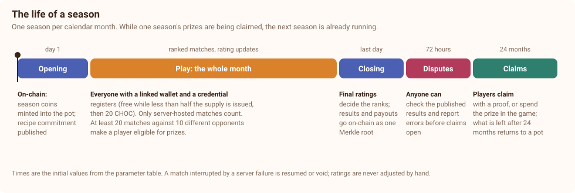

1. **Opening, day 1, 00:00 UTC.** The season's coins are minted into the pot (section 5.2). The season's parameters and the commitment to its recipes (section 6.2) are published.
2. **Play, the whole month.** Players register and play ranked matches. Registration is free until half of the supply is issued, then it costs 20 CHOC (section 5.3).
3. **Closing, last day, 23:59 UTC.** Final ratings decide the ranks. The server publishes the complete results and one Merkle root of all payouts on Cardano.
4. **Disputes, 72 hours.** Anyone can check the published results and report errors. A confirmed error leads to corrected results and a new root before claims open.
5. **Claims, 24 months.** Each player claims their prize with a proof, or spends it in the game directly (section 5.7). Prizes still unclaimed after 24 months return to a later pot.

The next season opens right after closing, so there is always a season running.

### 4.3 Tournament ruleset

Season matches use a ruleset that removes chance wherever it does not serve the strategy:

- **Mirrored boards.** Both players get the same generated board, mirrored. Neither starts with better fields.
- **No damage spread.** In the open ladder a shot's damage varies by ±20 %. In tournament matches it is always the average.
- **Hidden information stays.** Cream and donut traps hide decisions made by the players. That is uncertainty created by skill, not by chance.
- **Equipment within the budget.** Players can use tournament-legal items up to the shared loadout budget (section 6.3).

Season zero (section 13) measures how strongly skill decides matches under this ruleset, and the result is published (section 9.3).

### 4.4 Rating

- Players are rated with **Glicko-2**, which tracks both a player's skill and how certain that estimate is. New players start at 1500 with high uncertainty.
- A win against a stronger player raises the rating a lot; a win against a weaker player raises it a little. Losses work the same way in reverse.
- **Ranks use a conservative rating**: the rating minus twice its uncertainty. A few lucky wins cannot place a player at the top. Playing regularly makes a rating more certain, but grinding matches does not inflate it.
- Between seasons, every player keeps their rating, but its uncertainty grows back to at least the level of a player with about ten matches. Every season starts open.

### 4.5 Eligibility and identity

To receive a share of the pot, a player needs:

- **at least 20 ranked matches** in the season, against **at least 10 different opponents**;
- a **linked Cardano wallet**, connected through CIP-30 by signing a challenge from the server;
- a **verifiable credential** (KERI/ACDC, for example from a Veridian wallet). It proves three facts and nothing else: the holder is a unique person, is at least 18 years old, and does not live in an excluded country (section 9.7). battlechoc never receives the name, document or birth date behind it. It stores only a pseudonymous identifier, so that one person cannot register twice. battlechoc does not charge for the credential; any fee of the credential issuer is shown before the player starts.

**Against collusion and automated play:**

- the server detects repeated pairings between the same accounts and patterns of thrown matches;
- matches won by an opponent's immediate surrender or disconnect count toward the minimum number of matches only once per opponent;
- automated play is detected server-side; confirmed cases lose eligibility for the season.

### 4.6 Payouts

At closing, the pot is shared among all eligible players:

- **15 % participation share:** split evenly among all eligible players.
- **85 % rank share:** weights proportional to 1/rank, so first place gets twice the rank share of second place, three times that of third, and so on.

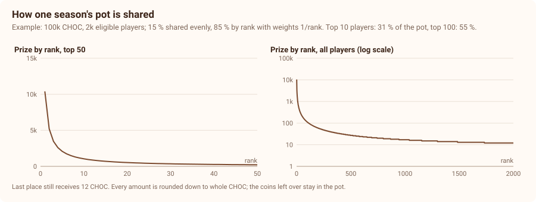

In the example above, with 100,000 CHOC and 2,000 eligible players, the top 10 players receive 31 % of the pot, the top 100 receive 55 %, and last place still receives 12 CHOC. CHOC has no decimals, so every amount is rounded down to whole coins; what is left over stays in the pot for the next season.

### 4.7 Incidents

- **Server failure:** the server stores every running match and continues it after a restart. A match that cannot be continued is **void**: no rating change and no drops for either player. Nothing is estimated or adjusted afterwards.
- **Disconnects:** a player who stays disconnected for longer than 60 seconds loses the match.
- **Bugs that changed results:** the affected matches are voided by the same rule. Ratings are never corrected by hand.
- **Errors in published results:** they are fixed during the dispute window (section 4.2). After claims open, results are final.

## 5. CHOC, the chocolate coin

### 5.1 Specification

| Property | Value |
| --- | --- |
| Name and ticker | battlechoc coin, CHOC (tickers are not unique on Cardano; the policy ID is the identity, published on battlechoc's website and repository) |
| Chain | Cardano, native token |
| Maximum supply | **10,000,000 CHOC** |
| Decimals | **none**; one CHOC is the smallest unit |
| Issuance | only into the tournament pot, by the schedule in section 5.2, enforced by the minting policy |
| Allocation to the team, investors or advisors | **none** |
| Sale | **none**: no presale, no ICO, no private round, no initial liquidity |
| Metadata | registered once in the Cardano Token Registry (CIP-26): name, ticker, logo, description; no metadata that anyone can change later |
| Admin key | **none**; nobody can mint outside the schedule or change it |

### 5.2 Issuance: a smooth halving

Each season mints new coins into its pot:

- **Season 1 mints 143,370 CHOC.**
- **Every following season mints 985,663 / 1,000,000 of the previous season**, rounded to the nearest coin. That halves the amount every 48 seasons (4 years), smoothly instead of in sudden steps.
- When the amount has fallen to 34 CHOC per season, rounding keeps it there, and minting stops when the total reaches 10,000,000 CHOC, in season 633.

The minting policy checks each season's amount with integer arithmetic, so the schedule is enforced on-chain.

| After | Issued | Share of the supply | Minted per season at that time |
| --- | --- | --- | --- |
| 1 year | 1,591,067 | 15.9 % | about 122,000 |
| 4 years | 5,000,114 | 50.0 % | about 72,700 |
| 8 years | 7,500,168 | 75.0 % | about 36,400 |
| 12 years | 8,750,272 | 87.5 % | about 18,200 |
| 20 years | 9,687,863 | 96.9 % | about 4,500 |
| 25 years | 9,869,012 | 98.7 % | about 1,900 |
| about 53 years | 10,000,000 | 100 % | 0 |

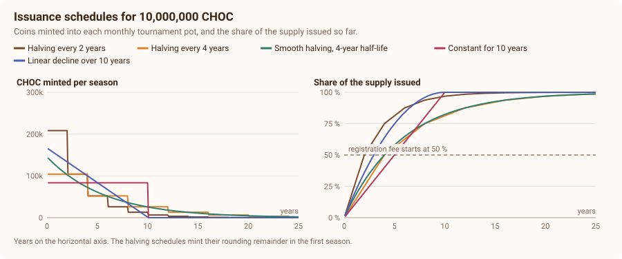

**Why a smooth 4-year halving?** In the simulation (section 7), a halving every 2 years spent the supply before the player base had settled. A smooth 4-year halving kept prizes higher for longer in every scenario and avoided the sudden prize drops of step-wise halvings.

### 5.3 Registration fee

- **Phase 1, free entry:** while less than half of the supply is issued, about the first 4 years, registration is free.
- **Phase 2, registration fee:** from the first season after 50 % of the supply is issued, registration costs **20 CHOC**. 19 CHOC go to the pot, 1 CHOC to the team. Phase 2 starts only after a legal review confirms that paid entry is allowed in the eligible countries (section 9.3). Until then, registration stays free.
- **Phase 3, issuance fades:** after about 25 years, new issuance is negligible. The pots are then funded by registration fees, crafting fees and returning prizes.

**Why a fee at all?** The fee is what returns prize coins to the pot. In the simulation, without a fee, players who only collect coins drained the pots: in the hoarding scenario, prizes per season fell to about 60 CHOC by year 25 with free entry, and stayed at about 27,000 CHOC with the fee (section 7.4). In the baseline and boom scenarios, the prize per entrant after 25 years was about six times higher with the fee than with free entry. Its cost is that some interested players cannot afford it; they keep playing the free open ladder, which still gives ingredients.

### 5.4 Uses of CHOC

| Use | Amount | Where it goes |
| --- | --- | --- |
| Season registration (phase 2) | 20 CHOC per season | 95 % pot, 5 % team |
| Crafting a common item | 50 CHOC | 90 % pot, 10 % team |
| Crafting a rare item | 100 CHOC | 90 % pot, 10 % team |
| Crafting an epic item | 200 CHOC | 90 % pot, 10 % team |
| Experimenting in the kitchen | free (costs ingredients only) | — |

**Round amounts.** Every fee is a multiple of 10 CHOC, so the 90/10 split is always exact. Registration fees are multiples of 20 CHOC, so the 95/5 split is exact as well. Payouts are rounded down; the remainder stays in the pot.

**Network fees.** Every Cardano transaction costs a small fee in ADA, typically 0.2 to 0.4 ADA. Players pay it for the transactions they start: claiming, registering, crafting and salvaging. A wallet output holding tokens also has to carry a minimum amount of ADA (about 1.2 ADA), which stays with the tokens and is not spent. battlechoc pays the fees of its own transactions, such as minting a season's coins and publishing roots.

### 5.5 How coins move

The diagrams show the average coins per season in the simulated baseline scenario with the recommended design: in year 3, while issuance pays most of the prizes, and in year 15, when players' spending does.

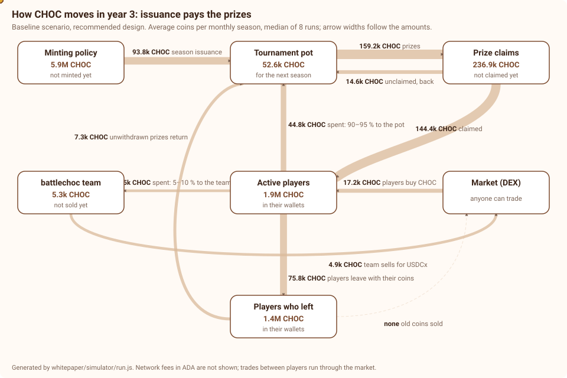

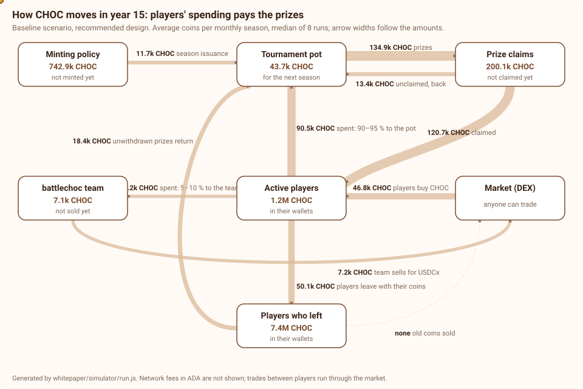

| Per season, baseline scenario | Year 3 | Year 15 |
| --- | --- | --- |
| New issuance into the pot | 93,800 | 11,700 |
| Fees spent into the pot | 44,800 | 90,500 |
| Returning prizes (unclaimed, unwithdrawn) | 21,900 | 31,800 |
| Prizes paid | 159,200 | 134,900 |
| Team share | 5,000 | 7,200 |
| Coins that leave with players who stop playing | 75,800 | 50,100 |

Two things stand out. First, the economy shifts from issuance-funded to spending-funded, as intended. Second, the largest outflow is not the team share but **players who stop playing and keep their coins**. That is their right, and it is the main reason why the pantry (section 5.7) and the fee exist.

### 5.6 No initial liquidity

battlechoc does not provide a liquidity pool, does not sell coins and does not pay exchanges, market makers or listing fees. The first coins exist after the first season's payout. Whether and where CHOC is traded is up to the players: anyone can create a pool on a decentralised exchange. battlechoc may work with decentralised exchanges and marketplaces on technical integration, such as showing the item metadata correctly, without paying or receiving money for it.

### 5.7 Prize claims: the pantry

Prizes do not go straight into wallets. They are recorded in the season's payout root, and the **prize-claims contract** (the "pantry") holds them for each player:

- a player can **withdraw** their prizes to their wallet at any time, with a proof;
- a player can **spend** them directly from the pantry on registration and crafting, without withdrawing first;
- prizes that are neither withdrawn nor spent within **24 months** after their season return to the pot of the season in which they expire.

The pantry does not take anything away from active players: withdrawing is always possible, and the deadline is known in advance. It brings back the prizes of players who stopped playing without ever collecting them. In the simulation, this was the single most effective measure against coins ending up in abandoned wallets (section 7.4).

## 6. Ingredients, recipes and equipment

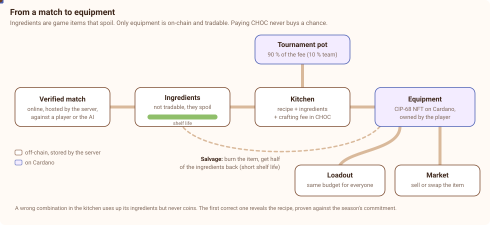

### 6.1 Ingredients

- After a **qualifying online match** in the open ladder, a player may find one ingredient. Ingredients are **game items stored by the server, not tokens**. They **cannot be traded**, and they **spoil**.
- **Qualifying** means: hosted by the server, at least 3 minutes long, and both players took actions. Matches against the server-hosted AI count with half the chance.
- **Chance per match:** 50 % after a loss, 80 % after a win, plus one more try when beating an opponent rated at least 100 points higher.
- **Daily limit:** the first 5 qualifying matches of a day (UTC) count fully, the next 10 with half the chance, then none. The same two players can earn drops against each other in at most 3 matches per day.
- **Rarity:** common 80 %, uncommon 17 %, rare 3 %.
- **No drops in paid tournaments.** Season matches give no ingredients once registration costs a fee. A paid entry is never combined with a chance-based reward.

| Ingredient | Rarity | Shelf life |
| --- | --- | --- |
| Milk, cream | common | 3 days |
| Cacao beans | common | 30 days |
| Sugar | common | 90 days |
| Cherries | uncommon | 7 days |
| Hazelnuts | uncommon | 14 days |
| Rum | uncommon | 180 days |
| Vanilla | rare | 5 days |
| Gold leaf | rare | 2 days |

Rare ingredients spoil fastest, so they reward players who are active when they find them, not players who stockpile.

### 6.2 Recipes and the kitchen

- A **recipe** combines 3 to 5 ingredients and a crafting fee into an item.
- **Recipes are discovered, not published.** In the kitchen, players combine ingredients. A combination that matches a recipe reveals it; one that does not uses up the ingredients, but never coins.
- **Six new recipes per season:** three common, two rare and one epic.
- **First discoverer:** the first player to find a recipe is named in the recipe's record, and the first item crafted from it carries the edition mark #1. The first edition is not stronger than later ones.
- **Recipe fragments** are rare drops that reveal one ingredient of an undiscovered recipe.
- **Provably unchanged recipes.** At the opening of a season, the server publishes on Cardano the salted root of a Merkle Patricia Forestry over all of the season's recipes. Whenever a recipe is discovered, the server reveals it with a proof that it was part of that root. Anyone can check that recipes were neither changed nor added during the season.
- **Open code, private content.** The game code is open source. The recipe table is game content and stays on the server, outside the public repository, until each recipe is discovered. After the season, the complete table is published.

### 6.3 Equipment

- Equipment is an **NFT on Cardano** (CIP-68) in the player's wallet. Each item is unique: it records its recipe, its crafter, the season and a serial number.
- **Every item has a gameplay effect.** It may also change how a unit looks, which tells the opponent what a player uses, unless the unit is hidden under cream. There are no purely cosmetic items.
- **Side-grades, not upgrades.** Every effect has a trade-off of at least 10 %, and no item changes a value by more than 30 %. Examples:

  | Item | Tier | Effect | Trade-off |
  | --- | --- | --- | --- |
  | Light barrel (truffle cannon) | common | −20 % reload time | −15 % damage |
  | Heavy rum barrel (truffle cannon) | rare | +25 % damage | +30 % reload time |
  | Dark chocolate walls (factory) | rare | +30 % hit points | building slots 10 % slower |
  | Turbo conveyor (factory) | epic | building slots 15 % faster | one storage space less |

- **Loadout budget: 10 points for every player.** Common items cost 2 points, rare items 3, epic items 5. At most one item per building type.
- **Rotation.** An item is tournament-legal in the season it was crafted and the two seasons after. It stays usable in the open ladder forever.
- **Balance updates.** Item effects live in CIP-68 reference data. The team multisig (section 8.3) can change them at most once per season, announced at least 7 days in advance with the reasons. Holders should expect effects to change when the game is rebalanced.
- **Royalties.** Secondary sales carry a CIP-27 royalty of 2.5 %, paid in ADA to the **security fund**, which pays for audits and bug bounties and is reported publicly (section 11.3).

### 6.4 Salvaging

Any holder can burn an item to get back **half of its ingredients**, rounded down, but at least one of the main ingredient:

- the crafting fee is not refunded;
- returned ingredients have a shelf life of 7 days, so crafting cannot be used to keep ingredients from spoiling;
- salvaging is the natural way out for rotated items, and it gives every item a lower bound for its usefulness.

## 7. Simulation and evidence

The parameters in this paper were chosen with an agent-based simulation. The simulator is in [`whitepaper/simulator`](simulator), runs without dependencies and is covered by tests: no coin is ever created or lost, every amount is a whole coin, and the pot moves exactly by its recorded flows. All charts in this paper are generated by it. Full results are in [`simulator/results.md`](simulator/results.md).

### 7.1 Model

- **One step is one monthly season**, over 25 years, with 8 random seeds per case.
- **Players** join to follow the scenario's population curve and leave with a chance of 5 % per month. Each player is a *spender* (enters, crafts, buys coins when short), a *casual* player (enters sometimes, sells more) or a *hoarder* (enters only while it is free and never spends, sells or buys).
- **Entry** depends on the fee: players weigh last season's prize per entrant plus the fun of playing against the fee.
- **Coins of players who leave** are partly sold on the way out. The rest stays in their wallets: 20 % of it is lost for good (lost keys), the rest can come back to the market slowly.
- **The pantry** is modelled through the players who leave without withdrawing their prizes: 30 % of spenders, 60 % of casual players and no hoarders.
- **The market** has no price. Buyers who are short of coins buy from the team, from leaving players, from players with a surplus and from former players, as far as those sell.

### 7.2 Scenarios

| Scenario | Players |
| --- | --- |
| Baseline | grows from 300 to 10,000 active players in about three years; 20 % hoarders |
| Hoarding | the same players, but 80 % hoarders, and former players never sell |
| Boom | grows to 50,000 active players within two years |
| Bust | grows to 5,000 players, then shrinks to a core of 200 from year three on |

### 7.3 Policies tested

| Policy | What changes |
| --- | --- |
| Draft v0.2 | halving every 2 years; a fixed 20 CHOC fee once 50 % is issued |
| Free entry | never a registration fee |
| Dynamic fee | the highest fee (in steps of 20 CHOC) that 85 % of interested players could pay |
| Pot reserve | each season pays out only 75 % of the pot |
| Smooth 4-year halving | the issuance of section 5.2 |
| Pantry | prizes in a claims contract; unwithdrawn prizes of former players return after 24 months |
| Free qualifiers | the top 10 % of the open ladder enter the paid season for free |
| **Recommended** | smooth 4-year halving, the pantry, and the 20 CHOC fee from 50 % issued: **this paper's design** |

### 7.4 Findings

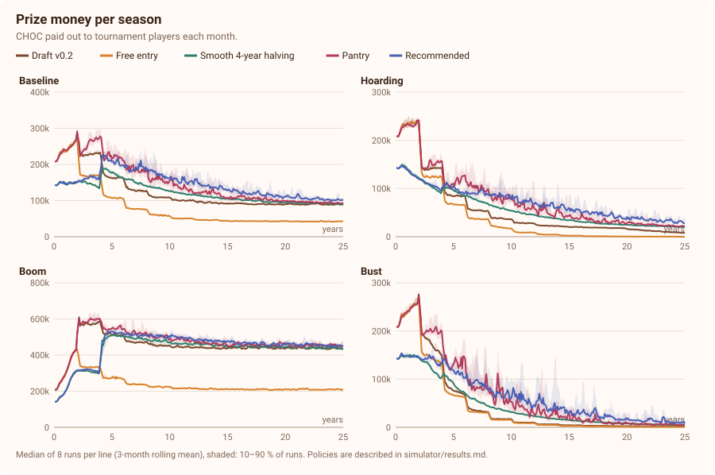

**1. The recommended design pays the highest or nearly the highest prizes in every scenario.**

| Prizes per season, median | Year 5 | Year 10 | Year 25 |
| --- | --- | --- | --- |
| Baseline, draft v0.2 | 159,800 | 108,700 | 86,100 |
| Baseline, recommended | 199,500 | 161,100 | 98,400 |
| Hoarding, draft v0.2 | 84,100 | 37,400 | 8,200 |
| Hoarding, recommended | 105,100 | 91,500 | 27,000 |
| Bust, draft v0.2 | 74,400 | 16,700 | 2,100 |
| Bust, recommended | 114,500 | 65,900 | 7,600 |
| Boom, draft v0.2 | 510,600 | 452,300 | 437,800 |
| Boom, recommended | 524,700 | 510,600 | 449,100 |

**2. Most coins end up with players who stopped playing.** With 5 % of players leaving each month, the wallets of former players hold 87 % of the supply after 10 years in the baseline with the draft design. The recommended design brings that down to 55 %, mainly through the pantry and the slower issuance. The economy runs on the coins that keep circulating, which is a small part of the supply.

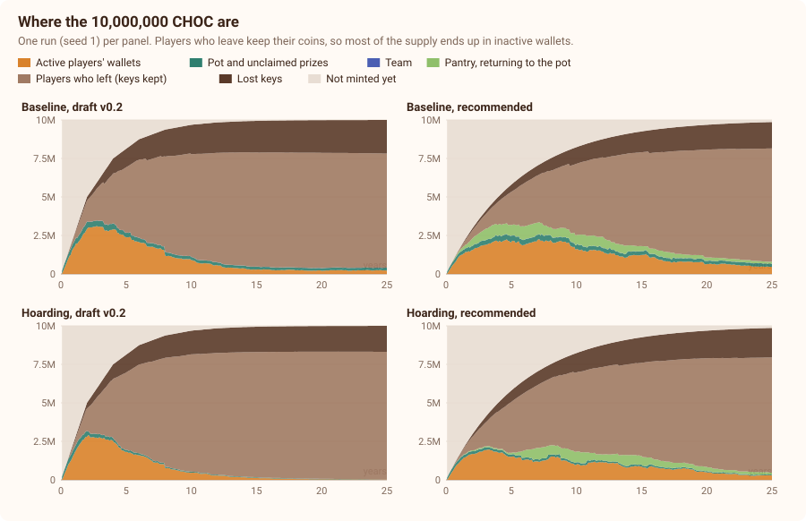

**3. Indivisible coins remain workable with 10,000,000 CHOC.** The risk was that coins become so scarce among active players that nobody can pay a fee of 20 whole coins. With the draft design that happened in the hoarding scenario: active players held 2 CHOC each on average by year 25. With the recommended design they held 28 CHOC each, and in every scenario the average stayed above the fee.

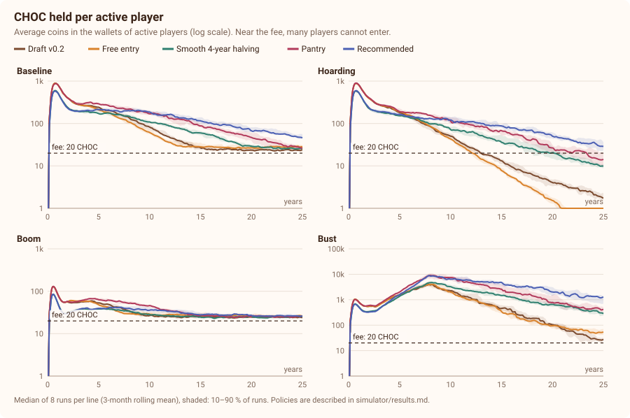

**4. Free entry pays less and fails under hoarding.** Free entry lets about 2.5 times as many players enter, but the prize per entrant falls to 7 CHOC in the baseline after 25 years (42 CHOC with the fee). In the hoarding scenario, free entry lets hoarders absorb the prizes until almost nothing is left: 62 CHOC per season after 25 years. The dynamic fee behaved like free entry, because a fee of 20 CHOC was rarely affordable for 85 % of interested players. Free qualification brought the same problem in through the back door: in the hoarding scenario it ended at 2,500 CHOC per season after 25 years.

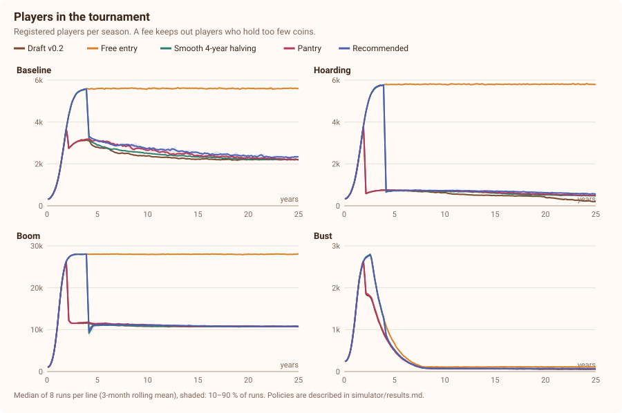

**5. A pot reserve only shifts prizes in time.** Paying out 75 % instead of the whole pot changed long-term prizes by only a few percent and was dropped.

**6. The fee keeps some players out.** With a fee of 20 CHOC, about half of the players who wanted to enter held enough coins in the model. Those players keep the open ladder. Whether this share is acceptable is checked in the test-network seasons. The fee can be lowered by governance (section 12), in steps of 20 CHOC, down to free entry.

### 7.5 Limits of the model

- It has **no price**. It cannot say what a CHOC or an item will be worth, and this paper makes no such claim.
- Player behaviour follows fixed profiles. Real players adapt, form teams and react to prices.
- Churn is a constant 5 % per month, and former players never come back.
- It does not model equipment effects, the kitchen, multi-accounting or bots, which the credential and the server's checks address.

The model shows how the rules behave under very different conditions. It is not a forecast.

### 7.6 Reproducing the results

```
node whitepaper/simulator/run.js            # all scenarios, 8 seeds, about one minute
node --test 'whitepaper/simulator/test/*.test.js'      # the simulator's tests
```

The command regenerates every chart in `whitepaper/figures` (except the three hand-drawn diagrams) and `simulator/results.md`.

## 8. Technical architecture

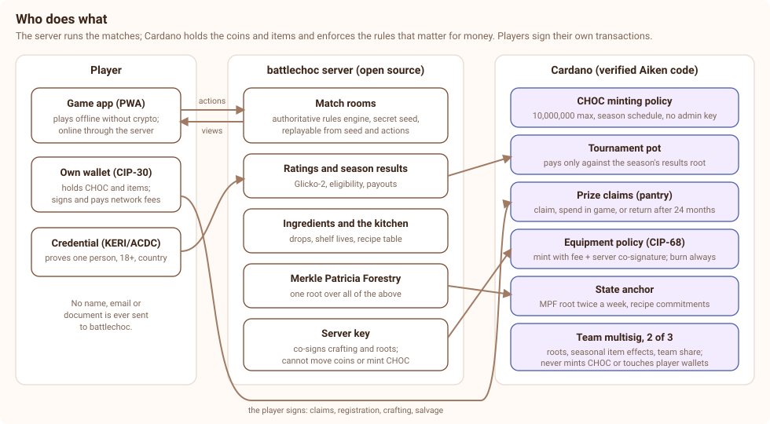

### 8.1 Game server

- The battlechoc server hosts all online matches and is the only authority on their state. It receives players' actions, applies the rules, draws random numbers from a secret seed and sends each player only what they may see.
- The rules engine is deterministic: every match can be replayed exactly from its seed and the list of actions. Before payouts, season matches are replayed and checked.
- The server code is open source. The server keeps ratings, eligibility, ingredients and the recipe table, and commits all of them to one Merkle Patricia Forestry.

### 8.2 Smart contracts

All validators are written in Aiken. Their source code is open, and the deployed scripts are verified on [uplc.link](https://uplc.link), so that anyone can check in explorers such as CardanoScan or Cexplorer that the code on-chain is the published code.

| Contract | Type | Rules it enforces |
| --- | --- | --- |
| CHOC minting policy | minting validator with a state token | One mint per season, into the pot only; the amount follows section 5.2; the total never exceeds 10,000,000; no admin key. |
| Tournament pot | spending validator | Coins leave only into the prize-claims contract, against a season's payout root signed by the team multisig, and only after the dispute window. |
| Prize claims (pantry) | spending validator | A player withdraws or spends their prize with a Merkle proof and their own signature; after 24 months, unclaimed prizes can only move back to the pot. |
| Equipment minting policy | minting validator (CIP-68) | Minting requires the crafting fee, split 90/10 to the pot and the team, and the server's co-signature confirming the ingredients were used. Burning (salvaging) is always allowed. |
| State anchor | data on-chain | The Merkle Patricia Forestry root of ratings, results, ingredients and recipe commitments, published twice a week. |

Players sign all their transactions with their own wallets. battlechoc never holds custody of players' coins or items.

### 8.3 Keys

- **Team multisig, 2 of 3:** Fabian Bormann, Sebastian Bode and a backup key held offline by an independent trustee. It publishes payout roots and anchors, updates item effects at most once per season, and receives the team share. It cannot mint CHOC, change the schedule, or touch coins in players' wallets or the pantry. In governance stage 3 it is replaced by the council's multisig (section 12).
- **Server key:** signs match results and co-signs crafting. It cannot move coins, mint CHOC or change item effects. It is rotated once a year and immediately after any incident, by the team multisig.
- **No admin key** exists for the CHOC minting policy.

### 8.4 Security

- Two independent audits of all validators before mainnet, the second on the exact deployed code.
- A public bug bounty from the first test-network season, paid from the security fund.
- Validators are tested with property-based tests, including the supply cap and the payout roots.
- Season roots and anchors can be verified by anyone with open tools published in the repository.

## 9. Regulatory approach

This section states the position battlechoc intends to take and the design choices that support it. It is not legal advice. **battlechoc will launch the token only after an independent legal review**, and the paid-entry phase only after a second review (section 5.3).

### 9.1 Crypto-asset rules (MiCA)

- CHOC is a crypto-asset in the sense of the EU's Markets in Crypto-Assets Regulation. It is neither an e-money token nor an asset-referenced token: it is not pegged to any currency or asset.
- MiCA's duties for issuers of such tokens (a crypto-asset white paper, notification of the authority) arise when someone offers the token to the public or asks for its admission to a trading platform. battlechoc does neither: it sells no CHOC, collects no money for it and does not apply for listings. Coins are distributed only as prizes.
- **If the legal review finds that MiCA's white-paper duty applies anyway,** for example because of the registration fee, battlechoc will publish a MiCA-compliant crypto-asset white paper and notify the competent authority before the first mainnet season.
- **Equipment** items are unique: each has its own serial, crafter, season and history. Unique, non-fungible crypto-assets are outside MiCA's scope. Because many items share a recipe, the legal review will also assess whether they could be treated as fungible.

### 9.2 Securities and investment rules

battlechoc avoids everything that makes a token look like an investment: there is no sale, no team allocation, no yield, no buyback, no price communication and no promise of value. The team's income comes only from the fee shares described in section 11.

### 9.3 Gambling, prize competitions and loot boxes

- **No paid randomness.** Nothing that costs CHOC has a random result. Crafting is deterministic, the kitchen costs no coins, and random drops exist only in free play, giving items that cannot be traded.
- **Phase 1 is a free prize competition.** As long as registration is free, players stake nothing.
- **Phase 2 is a paid skill competition.** Whether paid entry to a skill competition with prizes is allowed depends on the country. Phase 2 starts only after a legal review confirms it for the eligible countries; countries where it is not allowed are excluded from paid seasons or keep free entry.
- **Skill must dominate.** The tournament ruleset (section 4.3) removes avoidable chance. Season zero measures how well ratings predict results, and the analysis is published before phase 2. As a target, a player rated 200 points higher should win at least 70 % of tournament matches.

### 9.4 Players and consumers

- Seasons are open to adults only (18+), proven by the credential. The game itself is for everyone and needs no crypto.
- The rules, fees, deadlines and the expiry of unclaimed prizes are shown before registration and in this paper.
- Players get a downloadable statement of their prizes per season, to help with their own tax filings. Taxes are the players' responsibility.

### 9.5 Money laundering and sanctions

battlechoc handles no fiat money and holds no custody. Credentials exclude sanctioned countries. Prizes are limited to players with a unique credential, which also limits wash trading through prizes.

### 9.6 App stores

At launch, the season layer and wallet features are web only. The Android app (a Trusted Web Activity) and any other store builds offer the season layer only where the store's policy for blockchain features allows it.

### 9.7 Excluded countries

Excluded are all countries under EU or UN sanctions, and all countries where the legal review finds that prize competitions with crypto-asset prizes, or the paid phase, are not allowed. The list is published on the website and enforced through the credential.

## 10. Privacy

- battlechoc stores **no personal data**: no names, email addresses, phone numbers, birth dates or documents. Accounts are anonymous device accounts.
- For seasons, battlechoc stores a wallet address and a pseudonymous credential identifier. Under EU data protection law, wallet addresses can be personal data, so they are treated as such: they are used only for the season layer, never shared beyond the published results, and covered by the privacy policy.
- **Only roots and payouts go on-chain.** Full results are published off-chain, so that they can be removed on request; the root stays, but without the published list it reveals nothing.
- Player names are chosen freely and should not be real names.
- Single player stores everything on the player's device.

## 11. Team, finances and transparency

### 11.1 The team

battlechoc is developed by Fabian Bormann and Sebastian Bode, together with contributors under a contributor license agreement. Before the first test-network season, the team founds a limited liability company in Germany (a UG or GmbH), which operates the servers, holds the trademark and receives the team share.

### 11.2 Income

The team receives no coins from minting and holds no allocation. Its only income from the economy:

- 10 % of crafting fees and 5 % of registration fees, in CHOC;
- nothing from royalties, which go to the security fund.

In the simulated baseline, the team share was about 5,000 CHOC per season in year 3 and about 7,200 CHOC in year 15.

### 11.3 Spending and reporting

- The team sells its CHOC for USDCx, a USD stablecoin on Cardano, in small amounts spread over each month, so that its sales do not move the market.
- The money pays for servers, network fees, development, audits that the security fund does not cover, and marketing that explains the game, never the coin's price.
- A **quarterly report** shows income, sales and spending. A public dashboard shows the pot, the pantry, the security fund and the team multisig live from the chain.

### 11.4 Trademark

The name battlechoc, its logo and its characters are not covered by the open-source license. The team registers "battlechoc" as an EU trademark before mainnet. Forks of the game must use their own name and must not present their tokens or items as battlechoc's.

## 12. Governance and the transition to the community

battlechoc starts with a small team, because decisions need to be fast while the game and the economy are tested. The community takes over step by step, on fixed triggers.

| Stage | From | Who decides | Keys |
| --- | --- | --- | --- |
| 1. Team-run | test network until mainnet season 12 | the team, publishing its reasons with each change | team multisig, 2 of 3 |
| 2. Advisory | mainnet season 13 | players vote; passed proposals bind the team, unless they are illegal or break security, which the team must explain publicly | team multisig, 2 of 3 |
| 3. Community-run | mainnet season 37, if two votes in stage 2 reached the quorum | an elected council of 5 | council multisig, 3 of 5 |

**Voting:**

- **One verified person, one vote.** Voting weighted by coin holdings would hand the game to the richest players. A vote needs the season credential and eligibility in at least one of the last three seasons.
- A proposal needs the support of 50 eligible players to go to a vote. It passes with a simple majority and a quorum of 10 % of eligible voters.
- Council members are elected for 12 months, at most twice in a row. Team members may stand for election like anyone else.

**What governance can change, within bounds:**

| Parameter | Bounds |
| --- | --- |
| Registration fee | 0 to 100 CHOC, in steps of 20, at most once a year |
| Crafting fees | 10 to 500 CHOC, multiples of 10 |
| Participation share and rank exponent | 10–25 %, and 0.8–1.5 |
| Minimum matches and opponents | 10–40 matches, 5–20 opponents |
| Drop rates, shelf lives, recipes, item effects | within the side-grade rules of section 6.3 |
| The team's fee shares | can only go down |

**What nobody can change:** the maximum supply, the issuance schedule, the absence of any allocation or sale, and the absence of an admin key. These are enforced on-chain.

**If the team stops.** If the team can no longer run the servers, it hands the servers, the recipe data and the multisig to the council. If there is no council yet, it publishes the recipe data and the server configuration, so that the community can continue. Coins and items stay in the players' wallets in any case, and prizes in the pantry remain withdrawable until the end of their 24 months.

## 13. Roadmap

Each step starts only when the previous one has met its exit criteria.

| Step | Content | Exit criteria |
| --- | --- | --- |
| 1. Live game | the real-time game with online play on battlechoc's own servers | done in code; deployment pending |
| 2. Season zero | at least three seasons with ratings and payouts in points only, no token; the tournament ruleset; anti-cheat with server replays | at least 300 eligible players in one season; the skill analysis of section 9.3 published; no open critical exploit |
| 3. Test-network seasons | CHOC, pantry, kitchen and equipment on a Cardano test network; credentials; the bug bounty | at least two full seasons with claims; first audit done; all findings fixed |
| 4. Legal and company | the legal review (sections 9.1–9.7), the company, the trademark | written opinion; company registered |
| 5. Mainnet | the first CHOC season | second audit on the deployed code; scripts verified on uplc.link |
| 6. Phase 2 | the registration fee | 50 % of the supply issued (about year 4) and the second legal review |
| 7. Community | governance stages 2 and 3 | seasons 13 and 37, as in section 12 |

## 14. Risks

- **Regulation:** the legal reviews may require changes, delay the token or exclude countries. Paid entry may not be allowed everywhere.
- **Economy:**
  - Demand for CHOC and items may be low or volatile, and without initial liquidity there may be no market at first.
  - Coins of players who stop playing leave circulation. The pantry and the fee reduce this, but the economy always runs on a small circulating part of the supply.
  - Balance changes can change the usefulness, and with it the market value, of items.
  - Farming, multi-accounting and collusion may distort rewards despite the credential and the server's checks.
- **Technology:**
  - Smart contracts can contain bugs, despite audits.
  - The game server is a trusted party for match results. On-chain commitments make it auditable, not trustless.
  - Wallet keys are the players' responsibility; lost keys mean lost coins and items.
  - Credentials depend on issuers outside battlechoc's control.
- **The game:** a competitive economy only works if the game stays fun and fair. Fairness takes priority over revenue in every decision.

## 15. Parameters

Initial values. "Fixed" means enforced on-chain and not changeable by anyone; "governance" means changeable within the bounds of section 12.

| Parameter | Value | Changeable | Section |
| --- | --- | --- | --- |
| Maximum supply | 10,000,000 CHOC | fixed | 5.1 |
| Decimals | 0 | fixed | 5.1 |
| Issuance | season 1: 143,370 CHOC; then × 985,663 / 1,000,000 per season, rounded | fixed | 5.2 |
| Allocation, sale, admin key | none | fixed | 5.1 |
| Season length | one calendar month (UTC) | governance | 4.2 |
| Dispute window | 72 hours | governance | 4.2 |
| Claim period (pantry) | 24 months | fixed per season at opening | 5.7 |
| Registration fee | free until 50 % issued, then 20 CHOC | governance | 5.3 |
| Registration split | 95 % pot, 5 % team | governance (team share can only fall) | 5.4 |
| Crafting fees | 50 / 100 / 200 CHOC | governance | 5.4 |
| Crafting split | 90 % pot, 10 % team | governance (team share can only fall) | 5.4 |
| Kitchen experiments | no coin fee | governance | 6.2 |
| Participation share | 15 % | governance | 4.6 |
| Rank weights | 1 / rank | governance | 4.6 |
| Eligibility | 20 ranked matches, 10 different opponents, wallet, credential | governance | 4.5 |
| Rating | Glicko-2, ranked by rating − 2 × uncertainty | governance | 4.4 |
| Disconnect limit | 60 seconds | governance | 4.7 |
| Ingredient drops | 50 % per loss, 80 % per win, daily limits | governance | 6.1 |
| Shelf lives | 2 to 180 days | governance | 6.1 |
| New recipes per season | 6 (3 common, 2 rare, 1 epic) | governance | 6.2 |
| Loadout budget | 10 points (common 2, rare 3, epic 5) | governance | 6.3 |
| Item effect bounds | trade-off ≥ 10 %, no change above 30 % | governance | 6.3 |
| Rotation | the crafting season plus 2 | governance | 6.3 |
| Item effect updates | at most once per season, 7 days' notice | governance | 6.3 |
| Salvage return | 50 % of the ingredients, 7-day shelf life | governance | 6.4 |
| Royalties | 2.5 % in ADA to the security fund | governance | 6.3 |
| State anchoring | twice a week | governance | 8.2 |
| Team multisig | 2 of 3 (Fabian, Sebastian, trustee) | stage 3: council, 3 of 5 | 8.3 |
| Age limit | 18 | fixed by law | 9.4 |

## 16. Glossary

| Term | Meaning |
| --- | --- |
| ACDC | Authentic Chained Data Container: a verifiable credential format built on KERI. |
| Aiken | A programming language for Cardano smart contracts. |
| CHOC | The battlechoc coin. |
| CIP | Cardano Improvement Proposal. CIP-26: off-chain token metadata registry. CIP-27: royalties. CIP-30: wallet connection for web apps. CIP-68: tokens with reference metadata. |
| Credential | A digitally signed statement about a person, proven without revealing more than needed. |
| Glicko-2 | A rating system that tracks a player's skill and how certain that estimate is. |
| KERI | Key Event Receipt Infrastructure: a system for self-managed identifiers and keys. |
| Merkle Patricia Forestry (MPF) | A data structure whose single root value commits to a large set of records; a short proof shows that a record is part of it. |
| MiCA | The EU's Markets in Crypto-Assets Regulation. |
| Multisig | A key that needs signatures from several people to act. |
| Open ladder | Free online matches outside the season tournament. |
| Pantry | The prize-claims contract that holds a player's prizes until they withdraw or spend them. |
| Season | One calendar month of tournament play, ending with a payout. |
| Spending validator | A Cardano script that decides when coins at its address may be spent. |
| USDCx | A USD stablecoin on Cardano. |
| Veridian | An identity wallet and platform for KERI/ACDC credentials. |

## Appendix: changes since version 0.2

| Topic | Version 0.2 | Version 0.3 | Reason |
| --- | --- | --- | --- |
| Supply | in the millions | 10,000,000 CHOC | decided |
| Issuance | open | smooth halving, 4-year half-life | simulation: higher and steadier prizes in all scenarios |
| Claims | 90 days | pantry with 24 months, spendable in the game | simulation: strongest measure against abandoned coins |
| Registration fee | open amount | 20 CHOC from 50 % issued, after a legal review | simulation: protects the pots against hoarding |
| Free entry, dynamic fee, free qualifiers, pot reserve | not examined | tested and not adopted | section 7.4 |
| Tournament ruleset | not specified | mirrored boards, no damage spread | skill must dominate (section 9.3) |
| Rating | Glicko-2, final rating | conservative rating, soft reset | stops lucky streaks from deciding ranks |
| Multisig | 2 people | 2 of 3 with an independent trustee | one lost key must not lock the system |
| Governance | stages without triggers | fixed triggers, one person one vote, bounds | community transition |
| Royalties | open | 2.5 % to the security fund | royalties should not reward the team for trading |
| All other open parameters | open | decided initial values (section 15) | — |
